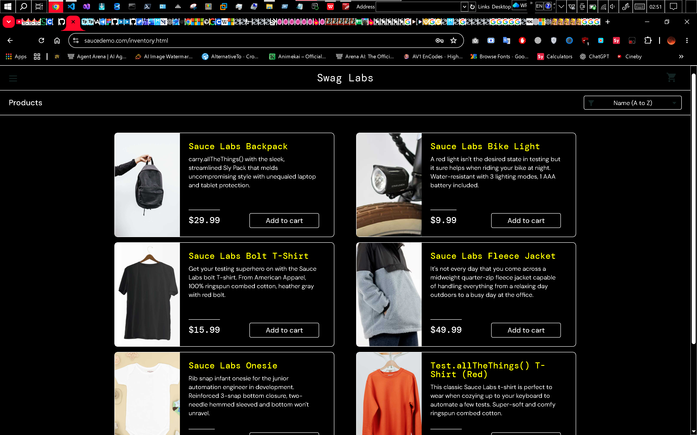
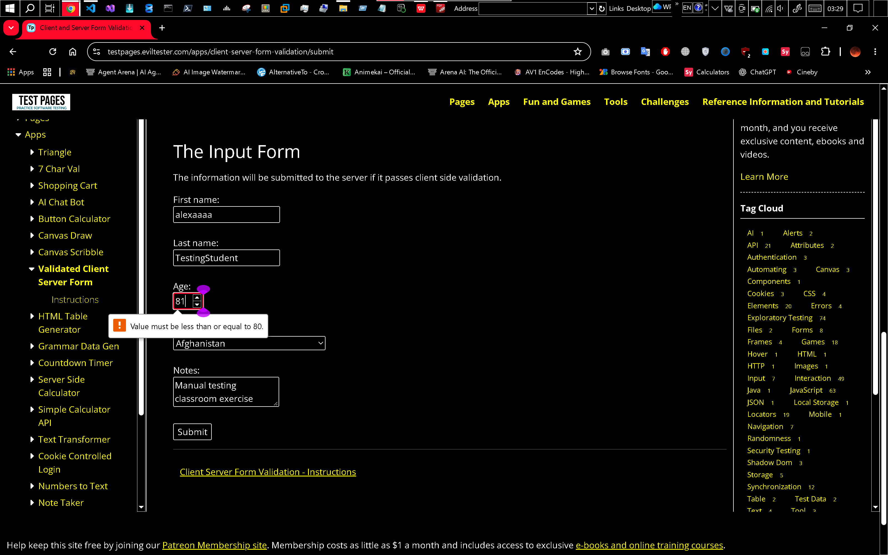

# Manual Testing Results — Member D

## Environment

| Item | Details |
|---|---|
| Tester identifier | member-d |
| Date and time | |
| Browser and version | |
| Operating system | |

## Login Tests

## Equivalence Partitioning

## 2-Point Boundary Tests

## 3-Point Boundary Tests

### Test ID: LOGIN-N03

| Item | Details |
|---|---|
| Test type | Negative |
| Tester | D |
| Website | [Website name](https://www.saucedemo.com/) |
| Status | Pass |

#### Purpose

Checks if user can login successfully if they dont enter their username

#### Preconditions

User must have an existing account

#### Test Data

| Field | Value |
|---|---|
| Username | Empty |
| Password | secret_sauce |

#### Steps

1.Follow the shared starting procedure.
2.Leave the username empty.
3.Enter the password.
4.Select Login.
5.Observe the feedback.

#### Expected Result

The attempt is rejected with validation feedback. The inventory is not reached.

#### Actual Result

User cannot login to their account and receives an error message

#### Evidence

### Test ID: AGE-2P-81-D

| Item | Details |
|---|---|
| Test type | Negative |
| Tester | member-d |
| Website | [Test Pages validation form](https://testpages.eviltester.com/apps/client-server-form-validation/) |
| Technique | 2-point boundary testing |
| Status | Pass |

#### Purpose

Check that an age immediately above the maximum is rejected.

#### Preconditions

The validation form is open.
All other fields will use the agreed valid baseline.

#### Test Data

| Field | Value |
|---|---|
| Age | `81` |
| Other fields | Agreed valid baseline |

#### Steps

1. Restore the validation form.
2. Enter the agreed baseline.
3. Replace age with `81`.
4. Submit.
5. Observe the response.

#### Expected Result

Age 81 is rejected because it is above the maximum age of 80.

#### Actual Result

Age 81 is rejected because it is above the maximum age of 80.

#### Evidence

### Test ID: AGE-3P-82-D

| Item | Details |
|---|---|
| Test type | Negative |
| Tester | member-d |
| Website | [Test Pages validation form](https://testpages.eviltester.com/apps/client-server-form-validation/) |
| Technique | 3-point boundary testing |
| Status | Pass |

#### Purpose

Check that an age immediately above the maximum is rejected.

#### Preconditions

The validation form is open.
All other fields will use the agreed valid baseline.

#### Test Data

| Field | Value |
|---|---|
| Age | `82` |
| Other fields | Agreed valid baseline |

#### Steps

1. Restore the validation form.
2. Enter the agreed baseline.
3. Replace age with `82`.
4. Submit.
5. Observe the response.

#### Expected Result

Age 82 is rejected because it is above the maximum age of 80.

#### Actual Result

Age 82 is rejected because it is above the maximum age of 80.

#### Evidence

---